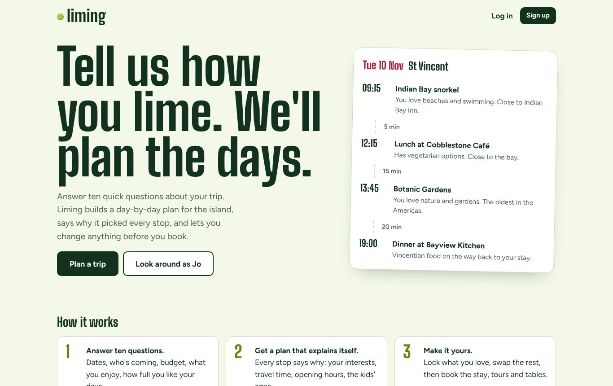
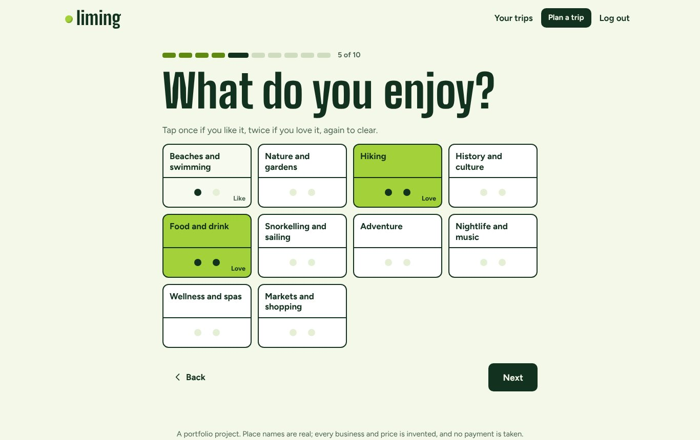
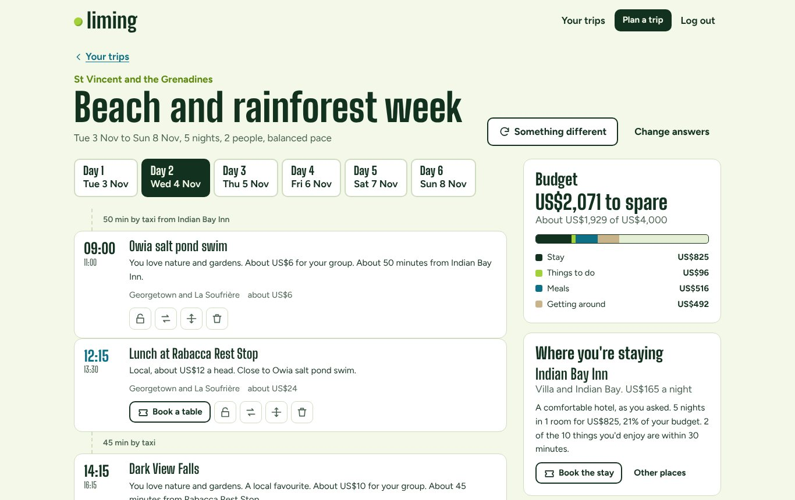
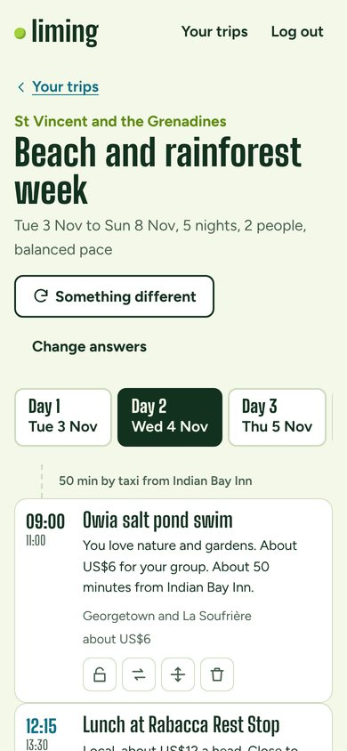

# Liming

*Liming (Caribbean English): relaxing, hanging out, taking it easy.*

A Caribbean trip planner. You answer a few questions (where, when, who's coming, budget,
pace, the kind of stay, how you like to eat, what you enjoy) and Liming builds a timed,
day-by-day itinerary, with a reason for every choice. Then it's yours to change: lock what
you love, swap anything for a suggested alternative, move things, add your own, and
regenerate the rest. When you're happy, book the stay, places on tours and restaurant tables.

> Place names are real; every business and price is invented demo data. No payments are taken.



| The questions | The plan | On a phone |
|---|---|---|
|  |  |  |

**Status:** Phase 3 of 4: planner, editing, booking, the web API and the React front end.
(PostgreSQL + CI come next.)

## Run it

```
py -m pip install -r requirements-dev.txt
py -m pytest                 # the test suite
py -m liming demo            # three travellers, three very different plans, then some editing
py -m liming init-demo       # build liming.db with Alembic and add demo accounts and a trip
py -m liming serve           # then open http://127.0.0.1:8000/  (API docs at /docs)
```

The built front end is committed (in `liming/web`), so running the app needs only Python.
Node.js is only needed to change the front end:

```
cd frontend
npm ci                       # install exactly the locked versions
npm run dev                  # live-reloading front end on :5173 (with py -m liming serve running)
npm test                     # unit tests (Vitest)
npm run build                # type-check, then build into ../liming/web
```

## The front end

React 19 + TypeScript, built with Vite, no other runtime libraries.

- **The questionnaire** asks one question per screen. Interests are domino tiles: tap once
  for one pip (*like*), twice for two (*love*), again to clear. The pips are the weights the
  planner actually uses.
- **The plan.** Day tabs, and a timeline where every stop shows why it's there and the travel
  time from the last one. Lock, swap (from ranked alternatives), move, remove or add from each
  stop. Then "Something different", "Redo this day", or change your answers and replan
  around what you locked.
- **Booking.** Hold a tour, a table or the stay, with a live 15-minute countdown, then confirm.
  Cancelling shows the refund first.
- **Types come from the API.** `py -m liming openapi` writes the API description, and
  `npm run api-types` turns it into TypeScript. A test fails if the committed description falls
  behind the real API, so the front end can't silently drift from the back end.
- **Safe and self-contained.** React escapes all text (a test checks nothing turns that off),
  the fonts are bundled, and a strict Content Security Policy allows only the app's own files.
- Works from 360px phones up, with visible keyboard focus and labelled controls.

Demo logins: `jo@example.test` and `kemar@example.test`, password `Liming-2026-demo`.

## How the planner decides

It's rule-based, not random and not AI: the same answers always give the same plan, and
every item says why it's there ("You love hiking. A local favourite. About 15 minutes from
Indian Bay Inn.").

1. **A place to stay.** It has to sleep everyone (in up to four rooms), suit children or
   step-free needs, and fit the budget. Among those, the best matches the style you asked
   for, costs a sensible share of the budget, and is close to the things you'd enjoy.
2. **The budget.** It's split into the stay, an estimate for meals and getting around, and
   what's left for activities. With a tight budget, the plan sticks to free things.
3. **Each day, slot by slot**: morning, lunch, afternoon, dinner, evening. Each slot takes
   the best-scoring option that:
   - is open that day and at that time, including tours that only run at set times
   - fits, with real travel time from the previous stop (worked out from distance, slower
     by bus, plus an hour for a ferry)
   - suits the youngest traveller and any step-free needs
   - suits every food need (vegetarian, vegan, gluten-free) and the dining budget
   - hasn't been done already, and is affordable

   Scores favour what you love over what you like, local favourites, and places near the
   last stop, so each day stays in one part of the island. Doing the same kind of thing
   every day costs points.
4. **Sensible days.** Pace sets how full the days are. Arrival day is light and the
   departure day just has check-out. A Friday fish fry *is* dinner. Something you love
   gets an early start if it needs one. Trips to another island are daytime only, back
   before the last ferry.

## Editing

- **Lock** an item, then **regenerate** (or ask for **something different**): locked items
  and anything you added stay put, and the rest is rebuilt around them.
- **Swap**: see what else would fit the same gap, best first, each with its reason.
- **Move** or **retime** anything; **add** your own plans, a catalogue activity or a meal.
- **Redo one day** without touching the others.
- **Choose another stay**; check-in and check-out follow it.

You're in charge, so edits are never refused for being a bad idea. Moving the market to its
closed hours is allowed, and the plan then shows a warning: *"Kingstown market morning is
open 07:00 to 14:00."*

## Booking

Hold something for 15 minutes, then confirm it, or the hold lapses and the space goes back
on sale. Space is always counted from the bookings themselves, never kept as a separate
number that could drift:

| What | Counted by | Cancelling |
|---|---|---|
| The stay | rooms, night by night (enough for everyone) | free until the stay's deadline before check-in, then the first night is kept |
| Activities that run at set times | places at each start time | free until 24 hours before, then non-refundable |
| Restaurant tables | seats at each lunch or dinner sitting | always free (there's no charge for a table) |

Holding or booking an item locks it in the plan, so regenerating never drops it, and it can't
be moved or removed until the booking is cancelled. While anything is booked, the country,
dates and group size can't change.

When two groups go for the last places at the same moment, exactly one gets them. The row is
locked on PostgreSQL, and SQLite takes its write lock up front. The race test forces the worst
timing on purpose, and fails if the lock is removed.

## The API

Interactive docs at `/docs`: log in with **POST /api/auth/login**, then paste the `csrf_token`
into **Authorize → X-CSRF-Token**.

| Area | Endpoints |
|---|---|
| Account | `POST /api/auth/register`, `/login`, `/logout`, `GET /api/me` |
| Questions | `GET /api/questions`: every valid answer, for building the questionnaire |
| Plan | `POST /api/trips` (answers → plan), `GET /api/trips/{id}`, `PATCH .../answers`, `POST .../generate`, `POST .../days/{date}/regenerate` |
| Editing | `POST /api/trips/{id}/items`, `PATCH/DELETE /api/items/{id}`, `GET .../alternatives`, `POST .../swap`, `GET/PUT /api/trips/{id}/stays`, `GET .../catalogue` |
| Booking | `POST /api/trips/{id}/stay/hold`, `POST /api/items/{id}/hold`, `POST /api/bookings/{id}/confirm`, `GET .../refund`, `POST .../cancel` |

Errors are always `{"detail": "a message you can show the traveller"}`: 400 a rule said no,
401 not logged in, 403 missing CSRF token, 404 not found (or not yours), 409 fully booked,
422 malformed request, 429 too many wrong passwords.

Security is the same design as my Jaunt project:
- random session cookies (`HttpOnly`, `SameSite=Lax`), with only their SHA-256 stored
- a CSRF token on every change
- login throttling, and the same answer for a wrong password or an unknown email
- scrypt password hashes and security headers

## Tests

- **150 random travellers.** Random dates, group sizes, children's ages, budgets, paces,
  food needs and access needs, across all five countries. Every plan must pass every rule
  (no overlaps, travel time respected, nothing closed, no one too young, food needs met, no
  repeats, no one stranded on another island, lunch and dinner every day).
- Tests that answers really shape the plan, that editing keeps your changes, and that two
  regenerations at once don't double the plan.
- Booking: capacity, lapsed holds, refunds, the plan's guards, and a forced race for the last places.
- The API through real HTTP requests: logins, CSRF, throttling, other people's things answering 404.
- A real-browser test (Playwright, when installed): sign up, answer the questions, lock, ask
  for something different, book the stay. Plus Vitest unit tests for the questionnaire logic.
- That test found a real bug. "Something different" used to *ban* everything already in the
  plan, which left a vegetarian family with a nearly empty week. It's now a strong preference
  instead, and a test checks the plan stays full.
- Each key rule was checked by breaking it on purpose and watching a test fail.
- A catalogue check: every tour's set start times fit its opening hours.
- Runs on SQLite and PostgreSQL.

## Built with

Python 3.11+, FastAPI, Pydantic 2, SQLAlchemy 2, Alembic, pytest, Playwright; React 19, TypeScript,
Vite, Vitest. Fonts: Big Shoulders Display and Figtree (SIL Open Font Licence).
